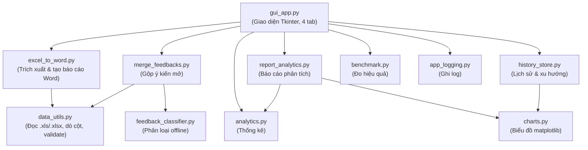

# Phần mềm Tổng hợp Khảo sát Đảm bảo Chất lượng

Phần mềm desktop giúp tự động hóa quy trình tổng hợp dữ liệu khảo sát ý kiến sinh viên (Excel) thành báo cáo Word theo mẫu Đảm bảo chất lượng (ĐBCL), kèm phân tích thống kê, biểu đồ trực quan và phân loại ý kiến thông minh.

> Khoa Khoa học Cơ bản – Đại học Y Dược TP. Hồ Chí Minh

---

## 1. Tính năng chính

| Nhóm | Mô tả |
|---|---|
| 📄 Tổng hợp báo cáo | Chuyển dữ liệu khảo sát từ Excel (`.xls`/`.xlsx`) sang báo cáo Word theo mẫu ĐBCL, hỗ trợ nhiều sheet và bản tổng hợp toàn khoa. |
| 📈 Phân tích thống kê | Tự động tính điểm trung bình, độ lệch chuẩn, tỷ lệ hài lòng, phân bố mức Likert; xuất báo cáo phân tích kèm biểu đồ. |
| 💬 Gộp & phân loại ý kiến | Trích xuất ý kiến mở, làm sạch, **phân loại theo chủ đề và sắc thái** hoàn toàn offline. |
| 📊 Xu hướng giữa các kỳ | Lưu kết quả từng đợt và vẽ biểu đồ xu hướng để minh chứng cải tiến liên tục. |
| ⚙️ Đo lường hiệu quả | Ước lượng thời gian tiết kiệm so với làm thủ công. |

---

## 2. Kiến trúc phần mềm



### Module

| File | Vai trò |
|---|---|
| [gui_app.py](gui_app.py) | Giao diện Tkinter, 4 tab, worker đa luồng |
| [excel_to_word.py](excel_to_word.py) | Trích xuất dữ liệu khảo sát, tạo báo cáo Word theo mẫu |
| [merge_feedbacks.py](merge_feedbacks.py) | Gộp và phân loại ý kiến mở |
| [data_utils.py](data_utils.py) | Lớp đọc thống nhất `.xls`/`.xlsx`, dò cột tự động, validate |
| [analytics.py](analytics.py) | Engine phân tích thống kê (thuần Python) |
| [charts.py](charts.py) | Sinh biểu đồ PNG bằng matplotlib |
| [report_analytics.py](report_analytics.py) | Tạo báo cáo phân tích Word kèm biểu đồ |
| [feedback_classifier.py](feedback_classifier.py) | Phân loại ý kiến theo chủ đề & sắc thái (offline) |
| [history_store.py](history_store.py) | Lưu lịch sử các kỳ, chuẩn bị dữ liệu xu hướng |
| [benchmark.py](benchmark.py) | Đo thời gian & ước lượng hiệu quả |
| [app_logging.py](app_logging.py) | Ghi log có cấu trúc ra file theo ngày |

---

## 3. Cài đặt & chạy

### Yêu cầu
- Python 3.9+ (khuyến nghị 3.12)

### Cài thư viện
```bash
python3 -m pip install -r requirements.txt
```

### Chạy ứng dụng
```bash
python3 gui_app.py
```

---

## 4. Đóng gói thành ứng dụng

### macOS (`.app`)
```bash
bash build_mac.sh
```
Kết quả: `dist/TongHopKhaoSat.app`

### Windows (`.exe`)
```bat
build_windows.bat
```
Kết quả: `dist/TongHopKhaoSat.exe`

> [!NOTE]
> Cả hai bản đóng gói đã được cấu hình để bao gồm `matplotlib` và `openpyxl` nhằm hỗ trợ biểu đồ và file `.xlsx`.

---

## 5. Kiểm thử

Bộ kiểm thử tự động (pytest) kiểm chứng tính đúng đắn của việc đọc dữ liệu, tính toán thống kê, phân loại ý kiến và tạo báo cáo:

```bash
python3 -m pytest tests/ -v
```

---

## 6. Quy trình sử dụng

1. **Tab Tổng hợp báo cáo**: chọn các file Excel khảo sát → chọn thư mục kết quả → nhấn "Tạo báo cáo". Phần mềm tạo báo cáo Word theo mẫu, báo cáo phân tích kèm biểu đồ, và tự lưu lịch sử.
2. **Tab Gộp Feedbacks**: chọn các file feedback → gộp, làm sạch và phân loại ý kiến tự động.
3. **Tab Phân tích & Xu hướng**: chọn học phần đã có lịch sử ≥ 2 kỳ → xuất biểu đồ xu hướng.
4. **Tab Cấu hình**: tùy chỉnh từ khóa, tiêu đề báo cáo và các tham số khác.

---

## 7. Dữ liệu & quyền riêng tư

- Toàn bộ xử lý diễn ra **cục bộ (offline)**, không gửi dữ liệu sinh viên ra ngoài.
- Log lưu tại thư mục `logs/` cạnh ứng dụng (hoặc `~/.dbcl_tonghop/logs`).
- Lịch sử khảo sát lưu tại `~/.dbcl_tonghop_history.json`.
