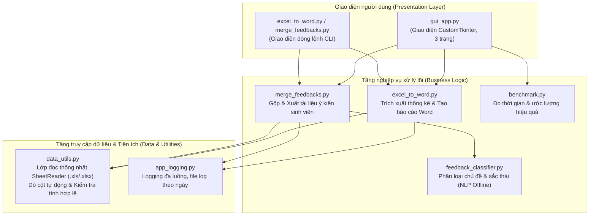

# Phần mềm Tổng hợp Khảo sát & Phân tích Ý kiến Sinh viên ĐBCL

<p align="center">
  
  
  
  
  
  
</p>

Ứng dụng desktop tự động hóa toàn diện quy trình **tổng hợp dữ liệu khảo sát ý kiến sinh viên** sau khi kết thúc học phần từ định dạng Excel (`.xls`, `.xlsx`) sang **báo cáo Word (`.docx`) theo mẫu chuẩn Đảm bảo chất lượng (ĐBCL)**, tích hợp module **làm sạch và phân loại ý kiến phản hồi mở bằng NLP offline**.

> **Đơn vị phát triển:** Khoa Khoa học Cơ bản – Đại học Y Dược TP. Hồ Chí Minh  
> **Tác giả:** Đặng Quốc Phong ([@dqphong0302](https://github.com/dqphong0302))

---

## 📌 Mục lục

- [1. Bối cảnh & Hiệu quả mang lại](#1-bối-cảnh--hiệu-quả-mang-lại)
- [2. Tính năng nổi bật](#2-tính-năng-nổi-bật)
- [3. Kiến trúc phần mềm](#3-kiến-trúc-phần-mềm)
- [4. Cài đặt & Khởi chạy](#4-cài-đặt--khởi-chạy)
- [5. Hướng dẫn sử dụng](#5-hướng-dẫn-sử-dụng)
  - [5.1 Sử dụng Giao diện Đồ họa (GUI)](#51-sử-dụng-giao-diện-đồ-họa-gui)
  - [5.2 Sử dụng Dòng lệnh (CLI)](#52-sử-dụng-dòng-lệnh-cli)
- [6. Quy ước định dạng dữ liệu đầu vào](#6-quy-ước-định-dạng-dữ-liệu-đầu-vào)
- [7. Đóng gói ứng dụng Standalone](#7-đóng-gói-ứng-dụng-standalone)
- [8. Kiểm thử tự động (Unit Tests)](#8-kiểm-thử-tự-động-unit-tests)
- [9. Cấu trúc thư mục dự án](#9-cấu-trúc-thư-mục-dự-án)
- [10. Quyền riêng tư & Bảo mật dữ liệu](#10-quyền-riêng-tư--bảo-mật-dữ-liệu)
- [11. Giấy phép bản quyền](#11-giấy-phép-bản-quyền)

---

## 1. Bối cảnh & Hiệu quả mang lại

Hằng năm, sau mỗi học kỳ, công tác đảm bảo chất lượng giáo dục đòi hỏi phải xử lý và tổng hợp hàng chục file dữ liệu khảo sát ý kiến sinh viên của từng lớp, từng tổ thành các báo cáo chi tiết. Khi thực hiện thủ công:
- **Tốn thời gian:** Trung bình mất 45–60 phút cho một báo cáo học phần và 30 phút để sao chép, làm sạch ý kiến phản hồi mở.
- **Dễ sai sót:** Dễ nhầm lẫn số liệu phần trăm, sai lệch tổng số phiếu, hoặc lỗi căn chỉnh bảng biểu văn bản Word.
- **Hạn chế tổng hợp:** Khó phân nhóm và lượng hóa các ý kiến đóng góp mở của sinh viên.

### Bảng so sánh Trước & Sau khi áp dụng phần mềm:

| Tiêu chí so sánh | Quy trình thủ công truyền thống | Ứng dụng tự động hóa (Phần mềm) |
|---|---|---|
| **Thời gian tạo 1 báo cáo** | 45 – 60 phút | **~ 2 – 5 giây** (Nhanh gấp > 200 lần) |
| **Xử lý file nhiều Sheet** | Sao chép, tính cộng dồn thủ công | **Tự động gộp dữ liệu các sheet** chuẩn xác |
| **Độ chính xác số liệu** | Có rủi ro sai sót (~5%) | **Chính xác tuyệt đối 100%** |
| **Định dạng văn bản** | Phải kẻ bảng, tô màu, chỉnh lề tay | **Tự động áp dụng chuẩn phông, lề, màu bảng ĐBCL** |
| **Phân tích ý kiến mở** | Đọc từng dòng, khó tổng hợp | **Tự động phân nhóm chủ đề & sắc thái bằng NLP** |
| **Bảo mật dữ liệu** | Phụ thuộc người xử lý | **Chạy 100% offline tại máy cá nhân, an toàn tuyệt đối** |

---

## 2. Tính năng nổi bật

### 📄 1. Trích xuất & Tạo Báo cáo Word ĐBCL tự động
- **Hỗ trợ đa định dạng Excel:** Đọc thống nhất cả file Excel phiên bản cũ (`.xls` qua `xlrd`) và phiên bản mới (`.xlsx` qua `openpyxl`).
- **Tự động nhận diện cấu trúc:** Dò tìm bảng câu hỏi khảo sát theo từ khóa, không phụ thuộc vào vị trí cố định của dòng/cột.
- **Thống kê điểm Likert 5 mức:** Tính toán số lượng phiếu, tỷ lệ phần trăm (%), điểm trung bình và tỷ lệ đồng ý theo đúng chuẩn biểu mẫu Nhà trường.
- **Hỗ trợ gộp Sheet thông minh:** Nếu file Excel chứa nhiều sheet (ví dụ: các lớp hoặc phân môn riêng biệt), phần mềm tự động gộp số liệu thành một bản tổng hợp duy nhất cho học phần.
- **Xử lý số lượng sinh viên vắng:** Hỗ trợ nhận diện số sinh viên không tham gia khảo sát từ hậu tố tên file (ví dụ: `TenMonHoc 2.xls` tương ứng 2 sinh viên vắng) hoặc từ ô cấu hình `F5`.

### 💬 2. Gộp & Phân loại Ý kiến Mở (Offline NLP)
- **Dò tìm cột ý kiến tự động:** Tìm cột ý kiến mở dựa trên tiêu đề cột (ví dụ: "Ý kiến đóng góp", "Feedback") với cơ chế fallback thông minh về cột cuối.
- **Làm sạch dữ liệu:** Loại bỏ các câu trả lời vô nghĩa hoặc không có ý kiến bằng danh sách từ khóa và mẫu Regex nâng cao (`không`, `không có ạ`, `dạ không`, `none`, `n/a`...).
- **Chuẩn hóa câu tiếng Việt:** Tự động tách câu đơn, viết hoa chữ cái đầu và thêm dấu chấm câu.
- **Phân loại chủ đề (Topic Classification):** Gom nhóm ý kiến vào các chủ đề thiết thực:
  - Giảng viên & Phương pháp giảng dạy
  - Nội dung & Chương trình học phần
  - Tài liệu học tập (Slide, giáo trình, bài đọc)
  - Lượng giá & Đánh giá (Thi, kiểm tra, chấm điểm)
  - Cơ sở vật chất & Trang thiết bị
  - Thời lượng & Tổ chức lớp học
- **Phân loại sắc thái (Sentiment Analysis):** Nhận diện sắc thái biểu cảm: *Tích cực (Khen ngợi)*, *Góp ý (Đề xuất cải tiến)*, hoặc *Trung tính*.
- **Xuất file Feedbacks.docx:** Trình bày bảng tổng hợp tỷ lệ phần trăm theo chủ đề/sắc thái và danh sách chi tiết các ý kiến đã phân loại.

### ⚙️ 3. Giao diện Tkinter hiện đại & Đo lường hiệu quả
- **Giao diện đa luồng (Multi-threaded GUI):** Không bị treo máy khi xử lý hàng loạt hàng chục file cùng lúc.
- **Bảng điều khiển Cấu hình (Settings Tab):** Tùy biến linh hoạt tiêu đề trường, tên khoa, quốc hiệu, cỡ chữ, phông chữ Times New Roman, lề trang, màu sắc bảng mà không cần can thiệp code.
- **Đo lường thời gian thực (Benchmarking):** Tính toán ngay sau khi chạy: thời gian chạy thực tế, số phút tiết kiệm được và hệ số tăng năng suất.
- **Hệ thống Logging hoàn chỉnh:** Ghi log song song lên màn hình giao diện và lưu file theo ngày (`logs/run_YYYYMMDD.log`).

---

## 3. Kiến trúc phần mềm



### Chi tiết các module:

| Tên tệp | Vai trò và chức năng chính |
|---|---|
| [`gui_app.py`](gui_app.py) | Giao diện CustomTkinter (thanh điều hướng + 3 trang: Tổng hợp báo cáo, Gộp Feedbacks, Cấu hình). Xử lý trên luồng nền, cập nhật giao diện qua hàng đợi. |
| [`excel_to_word.py`](excel_to_word.py) | Trích xuất số liệu khảo sát, tính toán Likert, ghép nhiều sheet và sinh file báo cáo `.docx`. Hỗ trợ cả CLI. |
| [`merge_feedbacks.py`](merge_feedbacks.py) | Đọc cột ý kiến mở, lọc câu trả lời rác, gọi bộ phân loại và xuất file `Feedbacks.docx`. Hỗ trợ CLI. |
| [`feedback_classifier.py`](feedback_classifier.py) | Bộ phân loại ý kiến mở theo chủ đề và sắc thái bằng luật từ khóa và ranh giới từ (word boundaries) hoàn toàn offline. |
| [`data_utils.py`](data_utils.py) | Lớp đọc thống nhất `SheetReader` cho cả `.xls` và `.xlsx`, thuật toán dò cột/dòng tiêu đề tự động và kiểm tra tính hợp lệ dữ liệu. |
| [`benchmark.py`](benchmark.py) | Đo thời gian chạy thực tế, tính toán thời gian tiết kiệm và hệ số tăng tốc so với quy trình thủ công. |
| [`app_logging.py`](app_logging.py) | Quản lý nhật ký xử lý, lưu vết có cấu trúc ra thư mục `logs/` theo ngày để phục vụ minh chứng vận hành. |

---

## 4. Cài đặt & Khởi chạy

### Yêu cầu hệ thống
- Hệ điều hành: macOS, Windows, hoặc Linux.
- Phiên bản Python: **Python 3.9 trở lên** (khuyến nghị Python 3.11 hoặc 3.12).

### Bước 1: Clone kho lưu trữ
```bash
git clone https://github.com/dqphong0302/dbcl_tonghop.git
cd dbcl_tonghop
```

### Bước 2: Tạo môi trường ảo và cài đặt thư viện
```bash
# Tạo môi trường ảo (khuyến nghị)
python3 -m venv .venv

# Kích hoạt môi trường ảo:
# Trên macOS / Linux:
source .venv/bin/activate
# Trên Windows (Command Prompt):
# .venv\Scripts\activate.bat
# Trên Windows (PowerShell):
# .venv\Scripts\Activate.ps1

# Cài đặt thư viện:
pip install -r requirements.txt

# (Tùy chọn) Cài thêm công cụ kiểm thử & đóng gói:
pip install -r requirements-dev.txt
```

Hoặc cài đặt dưới dạng gói Python nội bộ (editable mode):
```bash
pip install -e .
```

### Bước 3: Khởi chạy phần mềm
```bash
# Khởi chạy giao diện đồ họa GUI:
python3 gui_app.py

# Hoặc thông qua lệnh tiện ích (nếu đã cài đặt bằng pip install -e .):
dbcl-gui
```

---

## 5. Hướng dẫn sử dụng

### 5.1 Sử dụng Giao diện Đồ họa (GUI)

Ứng dụng cung cấp giao diện trực quan với 3 Tab làm việc:

#### 🔹 Tab 1: Tổng hợp báo cáo (Excel → Word)
1. **Thêm file Excel:** Nhấn nút **"Thêm file"** hoặc **"Thêm cả thư mục"** để chọn các file Excel khảo sát (`.xls` hoặc `.xlsx`).
2. **Chọn thư mục kết quả:** Chọn nơi lưu file báo cáo (mặc định sẽ lưu vào thư mục `output/`).
3. **Bắt đầu xử lý:** Nhấn **"▶ Bắt đầu xử lý"**. Tiến trình xử lý và nhật ký chi tiết sẽ hiển thị trên màn hình.
4. **Mở kết quả:** Nhấn **"📂 Mở kết quả"** để mở ngay thư mục chứa các file Word đã tạo.

#### 🔹 Tab 2: Gộp Feedbacks
1. Chọn các file Excel chứa ý kiến sinh viên (cột ý kiến đóng góp mở).
2. Nhấn nút **"💬 Gộp Feedbacks"**.
3. Phần mềm sẽ tự động loại bỏ câu trả lời trống, phân loại chủ đề/sắc thái và xuất ra tệp `Feedbacks.docx`.

#### 🔹 Tab 3: Cấu hình hệ thống
- Tùy chỉnh thông tin hành chính: Tên Trường, Tên Khoa, Quốc hiệu, Tiêu ngữ.
- Tùy chỉnh định dạng văn bản: Tiêu đề báo cáo, Phông chữ (`Times New Roman`), Cỡ chữ, Lề trang (Trên, Dưới, Trái, Phải), Màu nền tiêu đề bảng.
- Tùy biến từ khóa dò tìm ý kiến và biểu thức chính quy (Regex) để lọc câu trả lời rác.
- Nhấn **"💾 Lưu cấu hình"** để lưu vĩnh viễn vào máy cá nhân, hoặc **"🔄 Khôi phục mặc định"** để quay về chuẩn Nhà trường.

---

### 5.2 Sử dụng Dòng lệnh (CLI)

Phần mềm hỗ trợ đầy đủ các lệnh dòng lệnh dành cho việc tích hợp tự động hóa:

#### 1. Tổng hợp báo cáo khảo sát:
```bash
# Xử lý tất cả file Excel trong thư mục hiện tại:
python3 excel_to_word.py

# Xử lý 1 hoặc nhiều file chỉ định:
python3 excel_to_word.py "dulieu/D25 Giáo dục thể chất 2 25-26 HKI (gộp).xls"

# Xử lý theo thư mục đầu vào và đầu ra:
python3 excel_to_word.py --input-dir ./dulieu --output-dir ./output
```

#### 2. Gộp và phân loại ý kiến mở:
```bash
# Gộp các file feedback và lưu vào thư mục kết quả:
python3 merge_feedbacks.py dulieu/feedback1.xls dulieu/feedback2.xls -o ./output
```

---

## 6. Quy ước định dạng dữ liệu đầu vào

### 1. Cấu trúc bảng khảo sát ĐBCL
File Excel khảo sát sinh viên thường có vùng chứa tiêu đề *"THÔNG TIN KHẢO SÁT"* và gồm 8 cột chuẩn:
- Cột 1: STT và Nội dung câu hỏi khảo sát.
- Cột 2–6: Số lượng và tỷ lệ các mức đánh giá Likert từ mức 1 đến mức 5.
- Cột 7: Tổng số phiếu phản hồi.
- Cột 8: Điểm trung bình và tỷ lệ đồng ý.

### 2. Quy ước xác định Tổng số sinh viên
Để tính tỷ lệ tham gia khảo sát (% phản hồi), phần mềm áp dụng thứ tự ưu tiên:
1. **Hậu tố tên file (Khuyến nghị):** Thêm khoảng trắng kèm số sinh viên vắng vào đuôi tên file.  
   *Ví dụ:* `Duoc25 Sinh hoc dai cuong 3.xls` $\rightarrow$ Phần mềm hiểu có **3 sinh viên không tham gia khảo sát**. Tổng số sinh viên = Số phiếu + 3.
2. **Dữ liệu ô F5:** Nếu tên file không có số ở đuôi, phần mềm sẽ đọc giá trị tổng số sinh viên được ghi ở ô `F5` trong file Excel.

---

## 7. Đóng gói ứng dụng Standalone

### Tải bản build sẵn (khuyến nghị)
Mỗi lần push lên `main` hoặc mở Pull Request, GitHub Actions ([`build.yml`](.github/workflows/build.yml)) chạy kiểm thử rồi đóng gói:

| Artifact | Dành cho |
|---|---|
| `TongHopKhaoSat-Windows.exe` | Windows 10/11 (1 file, không cần cài Python) |
| `TongHopKhaoSat-macOS-AppleSilicon.zip` | Mac chip M1/M2/M3/M4 |
| `TongHopKhaoSat-macOS-Intel.zip` | Mac chip Intel |

Tải tại tab **Actions → lần chạy mới nhất → Artifacts**. Khi gắn tag phiên bản (vd. `git tag v3.0.0 && git push --tags`), workflow tự tạo **GitHub Release** đính kèm cả 3 file.

> macOS: ứng dụng chưa ký bằng Apple Developer ID, lần đầu mở hãy **chuột phải → Open (Mở)**.  
> Windows: nếu SmartScreen cảnh báo, chọn **More info → Run anyway**.

### Tự đóng gói trên máy
Cả hai nền tảng dùng chung một file cấu hình [`TongHopKhaoSat.spec`](TongHopKhaoSat.spec):

```bash
bash build_mac.sh          # macOS → dist/TongHopKhaoSat.app + dist/TongHopKhaoSat-macOS.zip
```
```cmd
build_windows.bat          :: Windows → dist\TongHopKhaoSat.exe
```

---

## 8. Kiểm thử tự động (Unit Tests)

Bộ kiểm thử tự động sử dụng `pytest` kiểm chứng tính toàn vẹn của logic trích xuất, thuật toán thống kê, bộ phân loại NLP và sinh tài liệu Word:

```bash
# Chạy toàn bộ test case:
python3 -m pytest tests/ -v
```

Các bộ kiểm thử bao gồm:
- `tests/test_core.py`: Kiểm thử đọc file khảo sát thật, tính toán điểm trung bình Likert, gộp nhiều sheet, lọc câu trả lời mở và tạo file Word hoàn chỉnh.
- `tests/test_classifier.py`: Kiểm thử bộ phân loại chủ đề, phân loại sắc thái và ranh giới từ vựng tiếng Việt (tránh nhầm lẫn substring như *khó* vs *khóa biểu*).
- `tests/test_benchmark.py`: Kiểm thử độ chính xác của bộ đếm thời gian và công thức ước lượng tiết kiệm.
- `tests/test_data_utils.py`: Kiểm thử lớp `SheetReader`, thuật toán dò header, và cơ chế phát hiện lỗi dữ liệu `ValidationReport`.

---

## 9. Cấu trúc thư mục dự án

```text
dbcl_tonghop/
├── .github/
│   └── workflows/
│       ├── build.yml            # CI/CD tự động build .exe và .app
│       └── test.yml             # CI/CD chạy kiểm thử tự động trên nhiều OS & phiên bản Python
├── docs/                        # Tài liệu hướng dẫn & Báo cáo SKKN
│   ├── Huong_Dan_Su_Dung_Phan_Mem_Tong_Hop_Khao_Sat.docx
│   ├── Huong_Dan_Su_Dung_Phan_Mem_Tong_Hop_Khao_Sat.pdf
│   ├── khao_sat_su_dung.md     # Đánh giá thực tế từ người dùng
│   ├── tool1_tong_hop_du_lieu.md
│   └── tool2_gop_feedbacks.md
├── tests/                       # Bộ kiểm thử tự động (Pytest)
│   ├── test_core.py             # Kiểm thử tích hợp luồng xử lý chính
│   ├── test_classifier.py       # Kiểm thử phân loại NLP ý kiến
│   ├── test_benchmark.py        # Kiểm thử module đo lường hiệu năng
│   └── test_data_utils.py       # Kiểm thử lớp đọc dữ liệu & xác thực
├── dulieu/                      # Dữ liệu mẫu phục vụ kiểm thử & thử nghiệm
├── app_logging.py               # Hệ thống ghi nhật ký hoạt động có cấu trúc
├── benchmark.py                 # Bộ đo thời gian & tính toán hiệu năng
├── assets/                      # Icon ứng dụng (.ico, .icns, .png)
├── TongHopKhaoSat.spec          # Cấu hình PyInstaller dùng chung Windows & macOS
├── build_mac.sh                 # Script đóng gói tự động cho macOS
├── build_windows.bat            # Script đóng gói tự động cho Windows
├── data_utils.py                # Lớp SheetReader thống nhất (.xls / .xlsx) & dò cột
├── excel_to_word.py             # Trích xuất dữ liệu khảo sát & tạo báo cáo Word
├── feedback_classifier.py       # Phân loại ý kiến mở theo chủ đề & sắc thái (NLP offline)
├── gui_app.py                   # Giao diện đồ họa người dùng (CustomTkinter)
├── merge_feedbacks.py           # Module gộp và làm sạch ý kiến mở
├── pyproject.toml               # Cấu hình chuẩn gói Python (PEP 621)
├── requirements.txt             # Danh sách thư viện phụ thuộc chính
├── requirements-dev.txt         # Thư viện phụ thuộc cho lập trình & kiểm thử
├── .gitignore                   # Cấu hình bỏ qua tệp tạm, cache, build
├── .gitattributes               # Cấu hình chuẩn hóa ký tự xuống dòng & tệp nhị phân
├── LICENSE                      # Giấy phép mã nguồn mở MIT
└── README.md                    # Tài liệu giới thiệu & hướng dẫn chi tiết
```

---

## 10. Quyền riêng tư & Bảo mật dữ liệu

- **Hoàn toàn Offline (Local-First):** Toàn bộ quy trình xử lý dữ liệu khảo sát và phân loại phản hồi sinh viên được thực thi 100% trên CPU máy tính người dùng.
- **Không gửi dữ liệu ra bên ngoài:** Phần mềm không sử dụng bất kỳ kết nối mạng hay dịch vụ AI trên đám mây nào, bảo đảm an toàn dữ liệu học vụ và quyền riêng tư của người học theo đúng quy định giáo dục.
- **Minh bạch:** Mã nguồn mở hoàn toàn, có thể kiểm tra từng dòng lệnh xử lý dữ liệu.

---

## 11. Giấy phép bản quyền

Dự án được phân phối dưới giấy phép mã nguồn mở [MIT License](LICENSE). Bạn được tự do sử dụng, chỉnh sửa và triển khai cho các đơn vị giáo dục khác.
