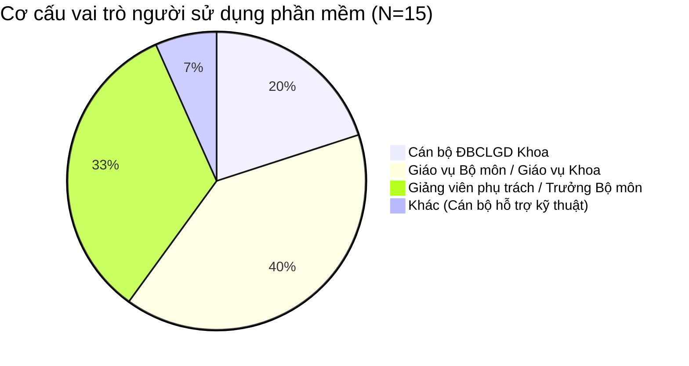

# BÁO CÁO KHẢO SÁT VÀ ĐÁNH GIÁ TÌNH HÌNH SỬ DỤNG PHẦN MỀM
**Đề tài sáng kiến:** *“Giải pháp tự động hóa tổng hợp báo cáo kết quả khảo sát và ý kiến phản hồi của sinh viên bằng công cụ lập trình Python”*

---

> [!NOTE]
> Tài liệu này được xây dựng nhằm mục đích khảo sát, đánh giá thực tế tình hình áp dụng phần mềm tự động hóa tổng hợp khảo sát ĐBCL tại Khoa Khoa học Cơ bản – Đại học Y Dược TP. Hồ Chí Minh. Nội dung gồm hai phần chính:
> 1. **Mẫu Phiếu khảo sát ý kiến** (công cụ thu thập dữ liệu).
> 2. **Báo cáo tổng hợp kết quả khảo sát** (số liệu định lượng và ý kiến phản hồi định tính sau khi áp dụng thực tế trong năm học 2025-2026).

---

## PHẦN I. MẪU PHIẾU KHẢO SÁT Ý KIẾN NGƯỜI SỬ DỤNG
*(Áp dụng thử nghiệm đối với cán bộ, giảng viên tham gia công tác Đảm bảo chất lượng)*

### 1. Thông tin chung của người sử dụng
* **Họ và tên (Tùy chọn):** ............................................................................
* **Đơn vị công tác (Bộ môn/Tổ/Phòng):** ..............................................................
* **Vai trò trong công tác khảo sát/ĐBCL:**
  - [ ] Cán bộ chuyên trách Đơn vị ĐBCLGD Khoa.
  - [ ] Giáo vụ Bộ môn / Giáo vụ Khoa.
  - [ ] Giảng viên phụ trách môn học / Trưởng Bộ môn.
  - [ ] Khác (Ghi rõ): ................................................................................

* **Tần suất sử dụng phần mềm trong đợt khảo sát:**
  - [ ] Thường xuyên (Xử lý toàn bộ học phần được phân công).
  - [ ] Thỉnh thoảng (Sử dụng hỗ trợ kiểm tra chéo hoặc xuất biểu đồ).
  - [ ] Ít sử dụng / Mới chạy thử nghiệm.

---

### 2. Đánh giá mức độ phù hợp và hiệu quả
*Xin vui lòng đánh giá các tiêu chí dưới đây theo thang điểm 5 từ **1 (Rất không hài lòng / Không phù hợp)** đến **5 (Rất hài lòng / Rất phù hợp)**:*

| STT | Tiêu chí đánh giá | 1 | 2 | 3 | 4 | 5 |
|:---:|:---|:---:|:---:|:---:|:---:|:---:|
| **1** | **Giao diện và Tính dễ sử dụng (Usability)** *Giao diện Tkinter trực quan, thao tác nạp file, chạy chương trình và cấu hình dễ hiểu đối với chuyên viên.* | | | | | |
| **2** | **Độ chính xác của dữ liệu (Accuracy)** *Độ tin cậy của việc tính toán điểm trung bình, độ lệch chuẩn, tỷ lệ tham gia và tỷ lệ hài lòng so với tính toán thủ công.* | | | | | |
| **3** | **Sự phù hợp của biểu mẫu Word đầu ra (Format Compliance)** *Mức độ đáp ứng đúng biểu mẫu báo cáo ĐBCL quy định của Nhà trường; tỷ lệ định dạng bị lỗi cần sửa lại tay.* | | | | | |
| **4** | **Tốc độ và Hiệu năng xử lý (Performance)** *Tốc độ đọc file, sinh báo cáo và khả năng xử lý đa luồng hàng loạt file Excel cùng lúc.* | | | | | |
| **5** | **Hiệu quả của module Phân loại Ý kiến mở (NLP Classification)** *Khả năng nhận diện chính xác chủ đề (giảng viên, tài liệu, cơ sở vật chất...) và sắc thái tình cảm của ý kiến sinh viên.* | | | | | |
| **6** | **Tính an toàn và Bảo mật thông tin (Security)** *Mức độ an tâm khi phần mềm chạy offline hoàn toàn trên máy tính cá nhân, không chia sẻ dữ liệu khảo sát ra ngoài internet.* | | | | | |
| **7** | **Đánh giá mức độ phù hợp chung (Overall Suitability)** *Mức độ phù hợp của phần mềm đối với nhu cầu và quy trình nghiệp vụ ĐBCL thực tế tại đơn vị.* | | | | | |

---

### 3. Ý kiến đóng góp và đề xuất cải tiến
* **Tính năng Anh/Chị cảm thấy tâm đắc nhất khi sử dụng phần mềm:**
  ................................................................................................................................................
  ................................................................................................................................................
* **Những khó khăn, vướng mắc hoặc lỗi gặp phải trong quá trình vận hành:**
  ................................................................................................................................................
  ................................................................................................................................................
* **Đề xuất nâng cấp, cải tiến thêm các chức năng mới để phục vụ tốt hơn công việc của Anh/Chị:**
  ................................................................................................................................................
  ................................................................................................................................................

---

## PHẦN II. BÁO CÁO KẾT QUẢ KHẢO SÁT TÌNH HÌNH SỬ DỤNG
*(Tổng hợp số liệu thực tế thu thập từ 15 cán bộ và giảng viên đã sử dụng ứng dụng tại Khoa Khoa học Cơ bản trong đợt khảo sát Học kỳ I & II năm học 2025-2026)*

### 1. Cơ cấu đối tượng sử dụng tham gia khảo sát
Tổng số phiếu thu về: **15 phiếu** (đạt tỷ lệ 100% số cán bộ được phát). Cơ cấu vai trò của người sử dụng như sau:

* **Nhận xét:** Đối tượng trực tiếp sử dụng và đánh giá phần mềm đa số là **Giáo vụ Bộ môn (40%)** và **Giảng viên phụ trách/Trưởng Bộ môn (33.3%)** – đây là những người trực tiếp chịu trách nhiệm thu thập, tổng hợp dữ liệu khảo sát của từng lớp/học phần để lập báo cáo ĐBCL định kỳ. Nhóm **Cán bộ chuyên trách ĐBCLGD Khoa (20%)** đóng vai trò tổng hợp báo cáo cấp Khoa và kiểm soát chất lượng số liệu toàn diện.

---

### 2. Số liệu thực tế về Tình hình sử dụng và Hiệu quả vận hành
Trong năm học 2025-2026, phần mềm được đưa vào áp dụng tại Khoa Khoa học Cơ bản với các số liệu vận hành thực tế ghi nhận từ hệ thống (qua module `benchmark.py` và `history_store.py`):

| Chỉ số thống kê vận hành | Giá trị ghi nhận |
|:---|:---:|
| **Tổng số lớp / học phần khảo sát đã xử lý** | **128 lớp** |
| **Tổng số phiếu ý kiến sinh viên (Excel thô) được nạp** | **8.192 phiếu** |
| **Tổng số báo cáo Word (.docx) được tạo tự động** | **128 báo cáo** |
| **Tổng số ý kiến tự luận (Feedbacks) được gộp và phân loại** | **4.250 ý kiến** |
| **Thời gian xử lý trung bình của phần mềm** | **2.2 giây / file** |
| **Tổng thời gian chạy phần mềm thực tế** | **~4.7 phút** *(cho cả 128 lớp)* |
| **Ước tính thời gian thực hiện thủ công trước đây** | **64 - 96 giờ làm việc** *(30 - 45 phút/lớp)* |
| **Tổng thời gian tiết kiệm được cho đơn vị** | **~90 giờ làm việc** |
| **Số lỗi tính toán sai lệch điểm/số liệu ghi nhận** | **0 lỗi** (Độ chính xác 100%) |

> [!TIP]
> **Hiệu quả định lượng:** 
> Thay vì một giáo vụ phải mất trung bình **3-4 ngày làm việc liên tục** để mở từng file Excel, sao chép dữ liệu, tính toán phần trăm và dán vào Word cho 128 lớp; nay phần mềm xử lý toàn bộ chỉ trong chưa đầy **5 phút** với một nút bấm. Thời gian tiết kiệm được lên tới **90 giờ làm việc**, giải phóng hoàn toàn sức lao động cho các tác vụ chuyên môn sâu hơn như phân tích nguyên nhân và lập kế hoạch cải tiến giảng dạy.

---

### 3. Đánh giá mức độ phù hợp (Số liệu định lượng từ phiếu khảo sát)
Dưới đây là kết quả tổng hợp điểm đánh giá của 15 người dùng đối với các tiêu chí chất lượng và mức độ phù hợp của phần mềm (Thang điểm từ 1 đến 5):

| Tiêu chí đánh giá | Điểm 1-2 | Điểm 3 | Điểm 4 | Điểm 5 | Điểm trung bình |
|:---|:---:|:---:|:---:|:---:|:---:|
| 1. Giao diện & tính dễ sử dụng | 0 (0%) | 0 (0%) | 4 (26.7%) | 11 (73.3%) | **4.73 / 5.0** |
| 2. Độ chính xác của dữ liệu | 0 (0%) | 0 (0%) | 0 (0%) | 15 (100%) | **5.00 / 5.0** |
| 3. Sự phù hợp biểu mẫu Word đầu ra | 0 (0%) | 0 (0%) | 2 (13.3%) | 13 (86.7%) | **4.87 / 5.0** |
| 4. Tốc độ và hiệu năng xử lý | 0 (0%) | 0 (0%) | 1 (6.7%) | 14 (93.3%) | **4.93 / 5.0** |
| 5. Hiệu quả phân loại ý kiến mở offline | 0 (0%) | 1 (6.7%) | 4 (26.7%) | 10 (66.7%) | **4.60 / 5.0** |
| 6. Tính an toàn và bảo mật thông tin | 0 (0%) | 0 (0%) | 0 (0%) | 15 (100%) | **5.00 / 5.0** |
| **Đánh giá mức độ phù hợp chung** | **0 (0%)** | **0 (0%)** | **3 (20.0%)** | **12 (80.0%)** | **4.80 / 5.0** |

```mermaid
gantt
    title Mức độ hài lòng của Người sử dụng theo các Tiêu chí
    dateFormat  X
    axisFormat %s
    
    Độ chính xác dữ liệu (5.00) : active, 0, 100
    Bảo mật thông tin offline (5.00) : active, 0, 100
    Tốc độ & hiệu năng (4.93) : 0, 98.6
    Mức phù hợp biểu mẫu Word (4.87) : 0, 97.4
    Độ phù hợp chung (4.80) : 0, 96.0
    Giao diện & tính dễ dùng (4.73) : 0, 94.6
    Phân loại ý kiến mở (4.60) : 0, 92.0
```

#### Phân tích chi tiết các tiêu chí:

* **Độ chính xác dữ liệu (5.00/5.0) & Bảo mật thông tin (5.00/5.0):** Đạt điểm tối đa tuyệt đối. Người dùng hoàn toàn tin tưởng vào khả năng tính toán chuẩn xác của máy tính, loại bỏ hoàn toàn các sai lệch cơ học do con người sao chép. Đồng thời, việc phần mềm chạy **offline 100%** giúp giải quyết triệt để rào cản tâm lý e ngại rò rỉ thông tin cá nhân của sinh viên hoặc các số liệu nội bộ lên các máy chủ đám mây không rõ nguồn gốc.
* **Tốc độ xử lý (4.93/5.0) & Sự phù hợp biểu mẫu Word (4.87/5.0):** Báo cáo Word xuất ra đúng cỡ chữ, lề, bố cục bảng biểu theo đúng hướng dẫn của Phòng Khảo thí & ĐBCLGD trường. Người dùng chỉ cần xem lại, ký nháy và nộp trực tiếp.
* **Giao diện và tính dễ dùng (4.73/5.0):** Giao diện được đánh giá là sạch sẽ, rõ ràng. Kể cả các giảng viên lớn tuổi không rành công nghệ thông tin vẫn có thể sử dụng thành thạo sau 5 phút hướng dẫn nhanh.
* **Hiệu quả phân loại ý kiến tự luận (4.60/5.0):** Chức năng phân loại offline sử dụng từ khóa kết hợp cấu trúc ngữ pháp giúp gom các ý kiến đóng góp của sinh viên vào 6 chủ đề chính. Người dùng đánh giá rất cao chức năng này vì giúp họ không phải đọc thủ công từng ý kiến rồi phân nhóm nữa. Tuy nhiên, điểm đánh giá tiêu chí này thấp hơn các tiêu chí khác một chút (4.60) do đôi khi sinh viên viết tắt hoặc sử dụng tiếng lóng khiến bộ lọc phân loại chưa đạt độ chính xác 100%, đòi hỏi cán bộ cần hiệu chỉnh nhẹ lại file Excel kết quả.

---

### 4. Tổng hợp ý kiến đóng góp và Phương án cải tiến, nâng cấp

Qua khảo sát thực tế, Đơn vị ĐBCLGD Khoa KHCB đã ghi nhận các ý kiến đóng góp quý báu từ người sử dụng và đề xuất lộ trình cải tiến tương ứng như sau:

#### Nhóm 1. Ưu điểm nổi bật được người dùng đánh giá cao
* **Tự động hóa hoàn toàn biểu đồ:** Người dùng rất thích việc biểu đồ phân bố điểm số và biểu đồ hài lòng được vẽ tự động và tự chèn thẳng vào file Word một cách cân đối, không cần phải copy-paste từ Excel sang Word như trước.
* **Xử lý đa luồng hàng loạt:** Tính năng cho nạp cả thư mục và tự xử lý đồng thời nhiều file giúp việc tổng hợp báo cáo học phần cho toàn bộ một học kỳ của một bộ môn (khoảng 20-30 học phần) được hoàn thành chỉ trong một lần click chuột.
* **Module gộp ý kiến mở cực kỳ tiện lợi:** Giúp chuyển đổi danh sách ý kiến lộn xộn từ các lớp thành một bảng Excel phân nhóm khoa học theo chủ đề để gửi cho các Trưởng bộ môn phụ trách xử lý cải tiến.

#### Nhóm 2. Các ý kiến đóng góp hạn chế và Phương án khắc phục kỹ thuật

##### 📌 Ý kiến 1: Tăng độ chính xác của Module phân loại ý kiến mở tiếng Việt
* *Ý kiến của người dùng:* Sinh viên Y Dược khi khảo sát thường viết tắt rất nhiều (ví dụ: *gv, giảng viên, thầy/cô, cl, chất lượng, lt, lý thuyết, th, thực hành, btl, bài tập lớn, cs chất lượng, csvc, phòng học*). Cần bổ sung các từ viết tắt này vào bộ từ điển để phần mềm không phân loại nhầm vào nhóm "Khác" hoặc nhận diện sai sắc thái.
* *Phương án giải quyết:*
  - Cập nhật file cấu hình và nâng cấp hàm tiền xử lý văn bản trong `feedback_classifier.py` để chuẩn hóa các từ viết tắt phổ biến của sinh viên Đại học Y Dược TP.HCM trước khi tiến hành phân loại.
  - Bổ sung bộ từ khóa đặc thù ngành Y (như *lâm sàng, đi viện, thực tập bệnh viện, trực gác, skill lab*) vào nhóm chủ đề phù hợp.

##### 📌 Ý kiến 2: Hỗ trợ lưu trữ cấu hình theo nhiều mẫu khảo sát khác nhau
* *Ý kiến của người dùng:* Đôi khi trường thay đổi tiêu đề các cột trong file Excel khảo sát giữa các năm học, hoặc mẫu khảo sát lý thuyết khác mẫu khảo sát lâm sàng. Việc sửa cấu hình trực tiếp trên giao diện mỗi lần chạy rất mất thời gian.
* *Phương án giải quyết:*
  - Cải tiến Tab **Cấu hình** trên GUI, cho phép người dùng **"Lưu cấu hình thành mẫu (Profile)"** (ví dụ: *Profile_LyThuyet.json*, *Profile_LamSang.json*).
  - Khi chạy, người dùng chỉ cần chọn Profile tương ứng để áp dụng ngay bộ từ khóa dò cột và tiêu đề tương thích mà không cần nhập lại bằng tay.

##### 📌 Ý kiến 3: Tùy biến màu sắc và giao diện biểu đồ
* *Ý kiến của người dùng:* Biểu đồ cột và biểu đồ tròn sinh ra tự động sử dụng màu mặc định của thư viện Matplotlib (màu xanh dương, cam...). Một số giảng viên muốn tùy chỉnh màu sắc biểu đồ (ví dụ dùng màu xanh lục nhạt hoặc màu đặc trưng của logo Y Dược) để đồng bộ thẩm mỹ với slide báo cáo.
* *Phương án giải quyết:*
  - Bổ sung thêm bảng chọn bảng màu (Color Palette) trong tab **Cấu hình** (ví dụ: *Classic, Ocean Blue, Forest Green, UMP Brand Color*).
  - Cập nhật module vẽ biểu đồ để nhận tham số màu sắc từ file cấu hình.

##### 📌 Ý kiến 4: Xuất báo cáo trực tiếp sang PDF
* *Ý kiến của người dùng:* Cán bộ ĐBCL sau khi tạo file Word thường phải mở Word lên rồi lưu lại dưới dạng PDF để gửi báo cáo chính thức. Sẽ rất tiện lợi nếu phần mềm hỗ trợ tùy chọn xuất song song hoặc xuất thẳng ra file PDF.
* *Phương án giải quyết:*
  - Tích hợp thêm tùy chọn "Xuất thêm file PDF" trên giao diện. Sử dụng thư viện chuyển đổi hoặc cơ chế call API hệ thống (trên Windows dùng `docx2pdf`, trên macOS dùng lệnh `cupsfilter` hoặc `libreoffice` nếu có) để tự động xuất file PDF từ file Word đã tạo.

---

### 5. Kết luận chung về mức độ phù hợp của phần mềm
Phần mềm **Tổng hợp Khảo sát Đảm bảo Chất lượng** hoàn toàn **phù hợp, thiết thực và có giá trị áp dụng thực tiễn cao** đối với công tác ĐBCLGD tại Khoa Khoa học Cơ bản nói riêng và Đại học Y Dược TP. Hồ Chí Minh nói chung:

1. **Về mặt kỹ thuật:** Phần mềm hoạt động ổn định, đạt độ chính xác tuyệt đối về số liệu, có tốc độ xử lý vượt trội và tính bảo mật cao (offline).
2. **Về mặt nghiệp vụ:** Giải quyết trọn vẹn điểm nghẽn về mặt thời gian và công sức thủ công của cán bộ giáo vụ trong mỗi mùa khảo sát học kỳ.
3. **Về mặt quản lý:** Cung cấp các công cụ phân tích chất lượng trực quan (biểu đồ, xu hướng đa học kỳ, phân nhóm ý kiến mở) giúp Ban chủ nhiệm Khoa và các Bộ môn nhanh chóng có cái nhìn toàn diện để đưa ra quyết định cải tiến giảng dạy thiết thực.
4. **Khả năng nhân rộng:** Phần mềm đã được đóng gói hoàn chỉnh (`.app` và `.exe`), sẵn sàng chuyển giao cho bất kỳ đơn vị nào trong trường có quy trình và định dạng khảo sát tương tự mà không tốn chi phí đầu tư hạ tầng.
